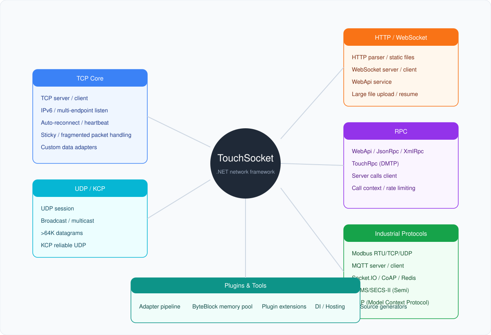

**En** | [中文](./README.zh.md)

## 30-Second Overview

**Socket**is an integrated .NET networking framework covering **TCP / UDP / WebSocket / HTTP / MQTT / Modbus / RPC / MCP** and more. It ships with a memory pool, data-adapter pipeline, plugin system, DI / Hosting integration, and source generators.

Whether you are building a TCP server, an industrial device gateway, or an AI tool based on MCP, Socketprovides a unified API to get you there quickly.

\---

## Feature Map

<p align="center">
  
</p>

\---

## Core Capabilities

|Capability|Description|
|-|-|
|**High-Performance IOCP**|Each receive uses a writable block from the memory pool with zero extra copies; up to \~10× throughput vs. traditional implementations in 100k × 64KB stress tests|
|**Data Adapters**|Fixed-header, fixed-length, terminator, HTTP, WebSocket templates; hot-swappable; automatic sticky/fragmented packet handling|
|**Plugin System**|Reconnection, heartbeat, SSL, authentication, logging via `.ConfigurePlugins()` across the full communication lifecycle|
|**Unified API**|TCP / UDP / WebSocket / NamedPipe / SerialPort all use `ConnectAsync / SendAsync / Received`|
|**Memory Pool**|ByteBlock, MemoryPool, Span / Memory optimized for low GC pressure under heavy traffic|
|**Source Generators**|AOT-friendly generation for RPC proxies, serialization, dependency properties, plugin raises|
|**Multi-Target**|.NET Framework 4.6.2 / .NET Standard 2.0 / .NET 6 / 8 / 10|

\---

## Package Quick Reference

|Category|NuGet Package|One-Liner|
|-|-|-|
|Core|`Socket.Core`|Memory pool, ByteBlock, adapter base, IOC, logging, plugins, serialization|
|Transport|`Socket`|TCP / UDP / SSL, KCP, NAT, WaitingClient, sticky/fragment handling|
||`Socket.NamedPipe`|Named-pipe IPC, \~3× faster than TCP|
||`Socket.SerialPorts`|Serial-port communication with adapter templates|
||`Socket.AspNetCore`|ASP.NET Core integration|
||`Socket.Hosting`|Generic Host support (Worker Service, etc.)|
|HTTP / Web|`Socket.Http`|HTTP/1.1 server/client, WebSocket, large-file transfer|
||`Socket.WebApi`|WebApi server + client with Swagger|
||`Socket.SocketIo`|Socket.IO client (v3/v4)|
|RPC|`Socket.Rpc`|RPC platform: registration, dispatch, execution, invocation|
||`Socket.Dmtp`|DMTP protocol: RPC, file transfer, channels, routing, Redis|
||`Socket.JsonRpc` / `Socket.XmlRpc`|JSON / XML RPC|
|IoT / Industrial|`Socket.Modbus`|Modbus RTU/ASCII/TCP master|
||`Socket.Mqtt`|MQTT server / client|
||`Socket.Semi`|HSMS/SECS-II semiconductor protocols|
||`Socket.CoAP`|CoAP over UDP|
||`Socket.Redis`|Redis client + in-memory compatible server|
|AI|`Socket.Mcp`|MCP server / client (stdio / Streamable HTTP)|
|Extensions|`Socket.Core.DependencyInjection` / `.Autofac`|Microsoft DI / Autofac adapters|
||`Socket.Rpc.RateLimiting`|RPC rate limiting|
||`\*.SourceGenerator`|Source generators for each package|

> All NuGet packages starting with `Socket.` are fully open-source and free for personal/commercial use. The `SocketPro.` line requires a commercial license.

\---

## Quick Start

### Install

```bash
dotnet add package Socket
```

### Minimal TCP Server

```csharp
var service = new TcpService();
service.Received = (client, e) =>
{
    Console.WriteLine($"Received: {e.Memory.Span.ToString(Encoding.UTF8)}");
    return EasyTask.CompletedTask;
};
await service.StartAsync(7789);
```

### Minimal TCP Client

```csharp
var client = new TcpClient();
client.Received = (c, e) =>
{
    Console.WriteLine(e.Memory.Span.ToString());
    return EasyTask.CompletedTask;
};
await client.ConnectAsync("127.0.0.1:7789");
await client.SendAsync("Hello");
```

### Auto-Reconnect

```csharp
client.ConfigurePlugins(a => a.UseReconnection<TcpClient>());
```

More examples are in [examples](./examples).

\---

## Performance

|Implementation|Memory Handling|Performance Impact|
|-|-|-|
|Traditional IOCP (fixed buffer)|Received data must be copied again|Extra overhead under load|
|**SocketIOCP**|Receives directly into a memory-pool block|**Zero extra copies**, significant gain at scale|

Stress test: **100k messages × 64KB** — Socketachieves **up to \~10×** the throughput of traditional implementations.

Named-pipe simple send/receive reaches **6.5 Gb/s**, about **3× faster than TCP**, with negligible GC.

\---

